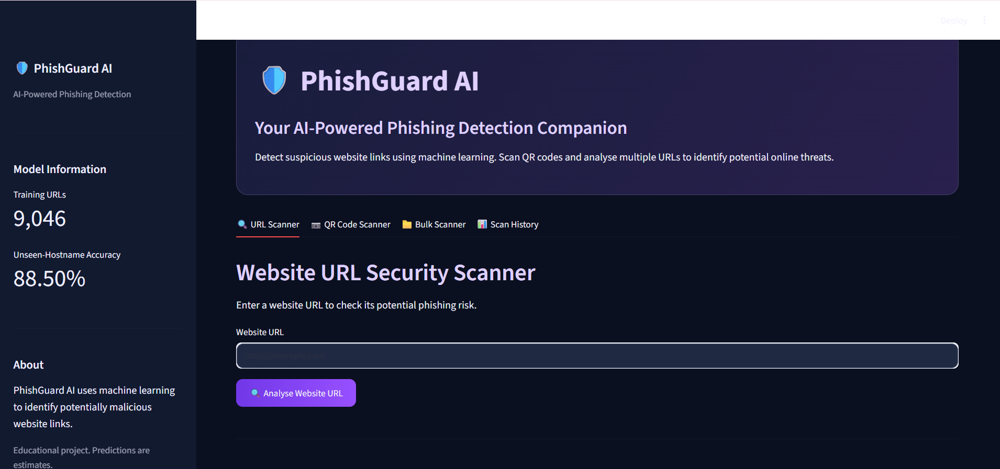
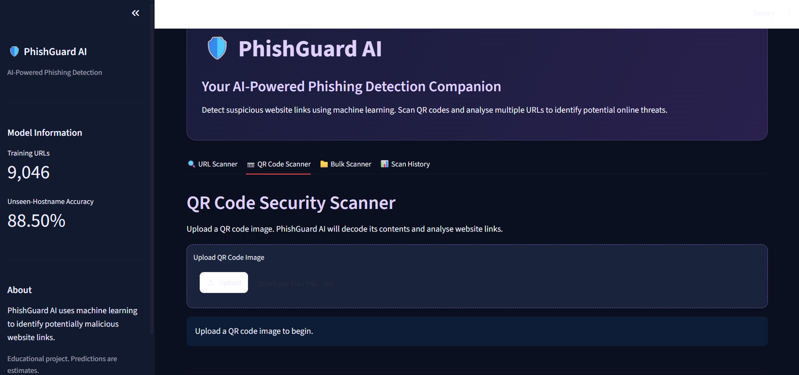
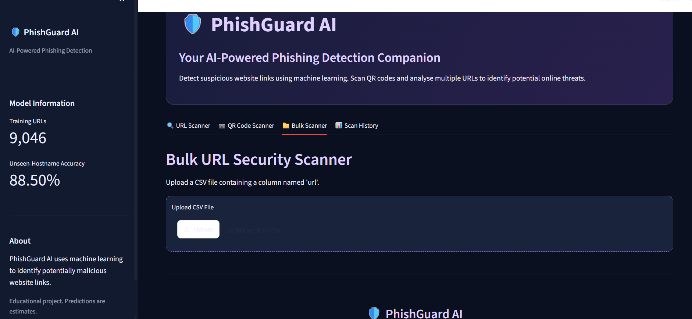
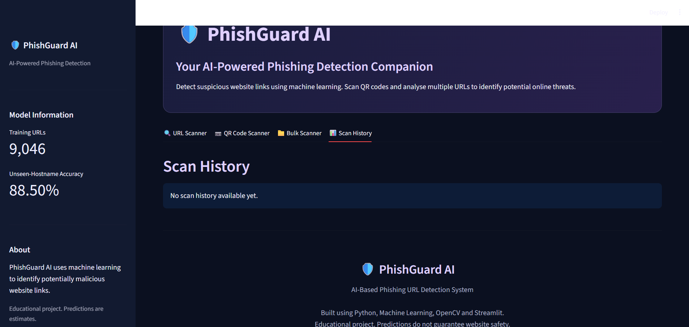

# 🛡️ PhishGuard AI

### AI-Based Phishing URL Detection System

PhishGuard AI is a machine learning-based web application that detects potentially malicious URLs and helps users identify phishing threats.

## Features

- **URL Scanner:** Analyse individual URLs for phishing threats.
- **QR Code Scanner:** Decode QR codes and analyse their URLs.
- **Bulk Scanner:** Scan multiple URLs using a CSV file.
- **Scan History:** View previously scanned URLs.
- **CSV Report:** Download scanning results.
- **Threat Analysis:** View phishing predictions, risk scores and URL indicators.

## Machine Learning Model

- Scikit-learn classification model.
- 24 engineered URL features.
- Dataset containing 9,046 URL records.
- Approximately 88.50% accuracy in unseen-hostname evaluation.

*Evaluation results do not guarantee real-world detection accuracy.*

## Technologies Used

- Python
- Scikit-learn
- Pandas
- NumPy
- Streamlit
- OpenCV
- ZXing-C++
- Joblib

## How to Run

Install the required libraries:

```bash
pip install -r requirements.txt
```

Run the application:

```bash
streamlit run app.py
```

## Future Improvements

- Improve detection accuracy.
- Integrate real-time threat intelligence.
- Add more advanced security analysis.

## Disclaimer

This project is developed for educational purposes. Predictions are not a guarantee that a website is safe or malicious.

**Developed as an Artificial Intelligence and Machine Learning project.**
## 📸 Application Screenshots

### Home – URL Scanner


### QR Code Scanner


### Bulk URL Scanner


### Scan History
